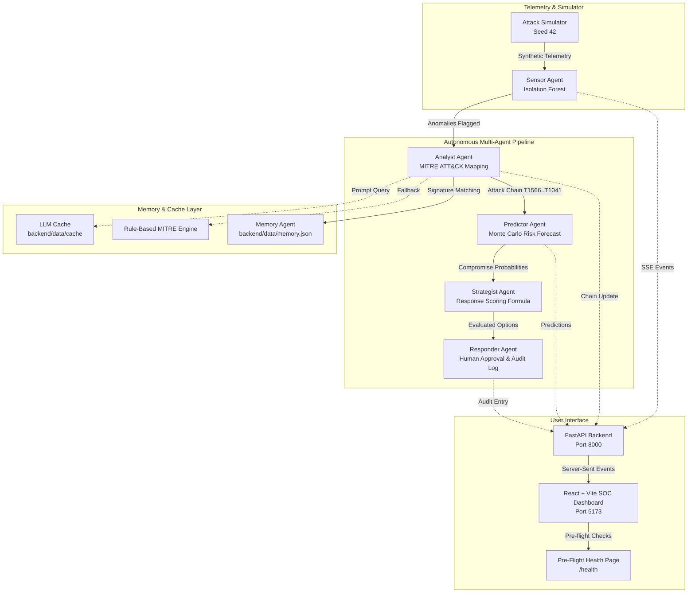

# CyberImmune 2.0


**NOTE: This is a strictly SIMULATED ENVIRONMENT. No real attack or scanning code is included or executed.**

CyberImmune 2.0 is an autonomous multi-agent digital immune system that detects a simulated cyberattack, reconstructs the attack chain (MITRE ATT&CK), predicts next steps via Monte Carlo simulation, evaluates response strategies, executes human-approved mitigations, and learns attack signatures for future defense.

---

## 🏛️ System Architecture



---

## 🚀 Setup Instructions

### Prerequisites
- **Python 3.10+**
- **Node.js 18+** & `npm`

### 1. Backend Setup
```bash
# Navigate to project root
cd d:/Projects/cyberimmune

# Activate virtual environment
source .venv/Scripts/activate   # On Windows: .venv\Scripts\activate

# Install Python dependencies
pip install -r requirements.txt

# Pre-seed baseline Memory signatures and LLM response cache
python backend/scripts/preseed_memory.py
python backend/scripts/preseed_llm_cache.py

# Launch FastAPI backend server
uvicorn backend.api.main:app --host 127.0.0.1 --port 8000 --reload
```

### 2. Frontend Setup
```bash
# In a new terminal window:
cd d:/Projects/cyberimmune/frontend

# Install Node dependencies
npm install

# Start Vite development server
npm run dev
```
Open your browser to `http://localhost:5173/health` to verify system health.

---

## ⏱️ 3-Minute Demo Script

| Timeframe | Step | Actions & What to Observe |
| shadow |---|---|
| **0:00 - 0:30** | **Pre-Flight Health Verification** | Navigate to `http://localhost:5173/health`. Observe that all 4 health cards (**Backend API**, **LLM Cache**, **Seeded Memory**, **SSE Stream**) display **GREEN PASS** and overall system status is **SYSTEM READY FOR DEMO**. Click **Launch Dashboard**. |
| **0:30 - 1:30** | **Launch 4-Stage APT Attack** | On the SOC Dashboard, click **Launch Attack**. Watch the real-time event feed stream telemetry via SSE. The **Sensor Agent** flags anomalies, the **Analyst Agent** constructs the 4-stage MITRE ATT&CK chain (`T1566` Initial Access → `T1021` Lateral Movement → `T1068` Privilege Escalation → `T1041` Exfiltration), and the **Memory Agent** flags `KNOWN PATTERN (88% match)` against historical signature `inc-hist-001`. |
| **1:30 - 2:30** | **Risk Forecast & Human-in-the-Loop Response** | Observe **Predictor Agent** Monte Carlo risk forecasts (host compromise probabilities & time-to-compromise). Review **Strategist Agent** response cards evaluated with scoring formula `score = 0.6 * risk_reduction - 0.4 * business_impact`. Click **Approve** on the recommended option (*Isolate Host*). Notice the **Responder Agent** logs execution to the audit log. |
| **2:30 - 3:00** | **Markdown Report & Demo Reset** | Click **Incident Report** in the top navigation to view the generated executive markdown report. Click **Reset Demo** in the top control bar. Notice that the entire state restores to clean initial state in **under 1 second (< 50ms)**. |

---

## ⚖️ Simulated vs. Real Production Systems

| Architecture Aspect | Simulated Environment (CyberImmune 2.0) | Real Production System |
|---|---|---|
| **Telemetry Generation** | Synthetic Pandas DataFrames generated with `AttackSimulator(seed=42)` representing auth, DNS, file access, and network logs. | Real-time agent collectors (e.g. Elastic Agent, CrowdStrike Falcon, Sysmon, Osquery) streaming syslog/eBPF events. |
| **Attack Vectors** | Pre-scripted 4-stage APT attack scenario mapped to MITRE ATT&CK techniques (`T1566`, `T1021`, `T1068`, `T1041`). | Live threat telemetry, zero-day exploit payloads, real malware behavior, and dynamic adversary tactics. |
| **Agent Execution** | Local Python multi-agent pipeline using IsolationForest, Monte Carlo simulations, Pydantic type validation, and disk caching. | Scalable distributed microservices / serverless functions communicating via Kafka or Cloud Pub/Sub with LLM orchestration. |
| **Response Actions** | Simulated network isolation, firewall IP block, and account suspension recorded to `audit_log.jsonl`. | Automated API integrations with firewalls (Palo Alto, Fortinet), EDR (CrowdStrike, SentinelOne), and IAM (Okta, Azure AD). |
| **Human Control & Audit** | Built-in human-in-the-loop approval thresholds for high-impact actions (`business_impact > 0.30`) with strict audit logging. | Enterprise SOC workflow integration (ServiceNow, Jira Security, SOAR playbooks) enforcing strict regulatory oversight. |

---
